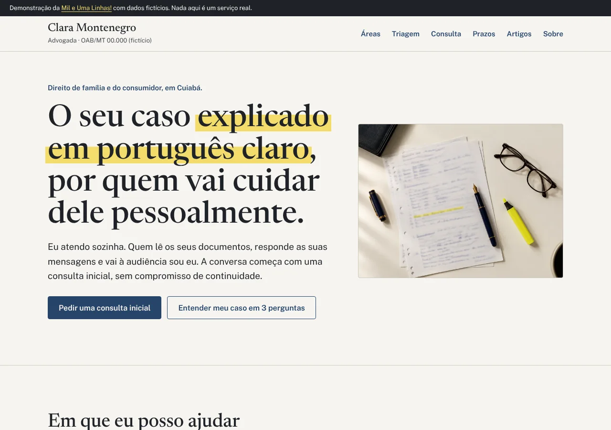
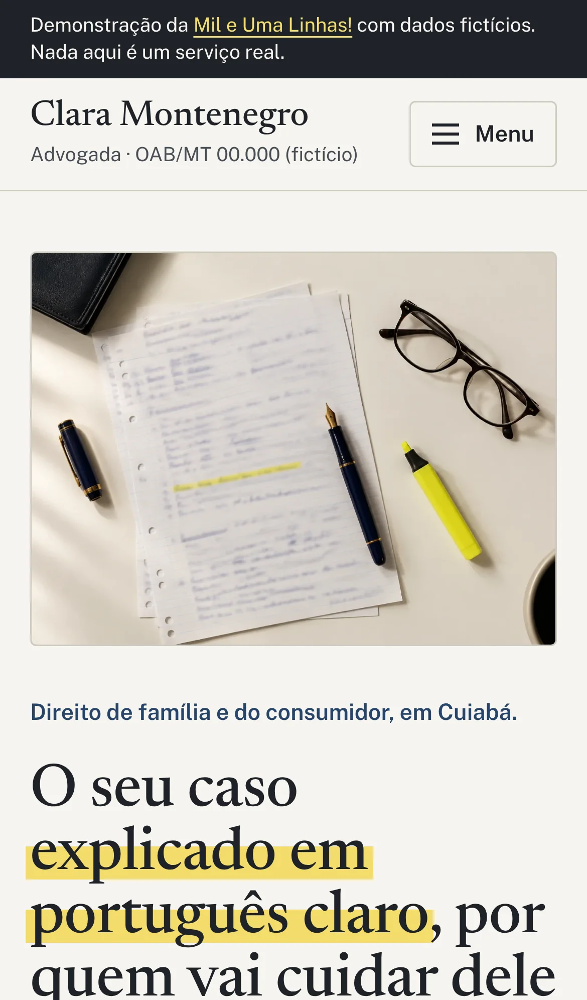
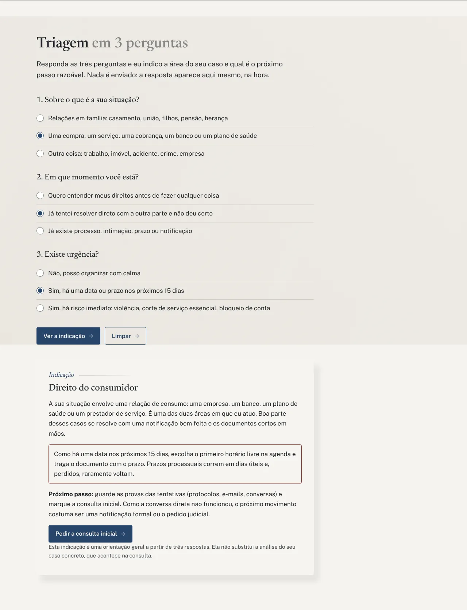
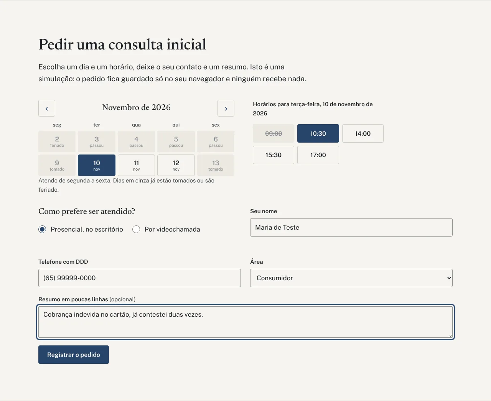
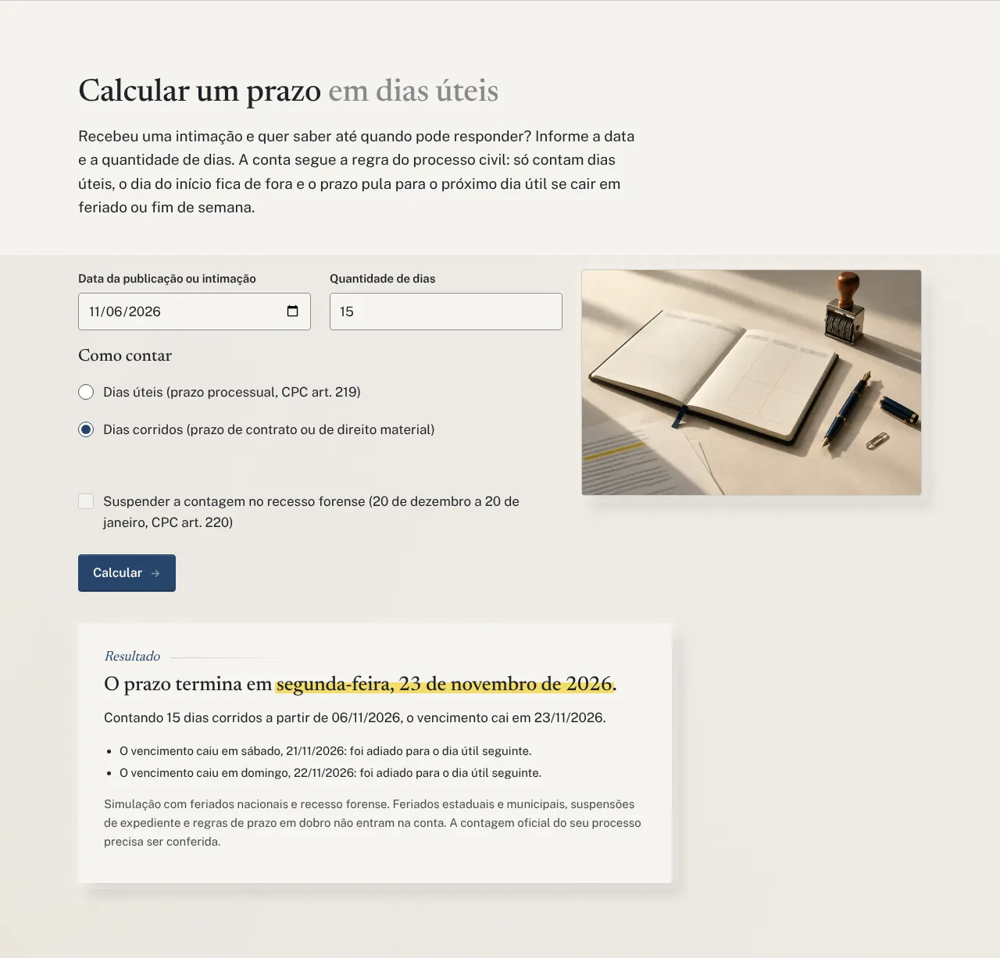
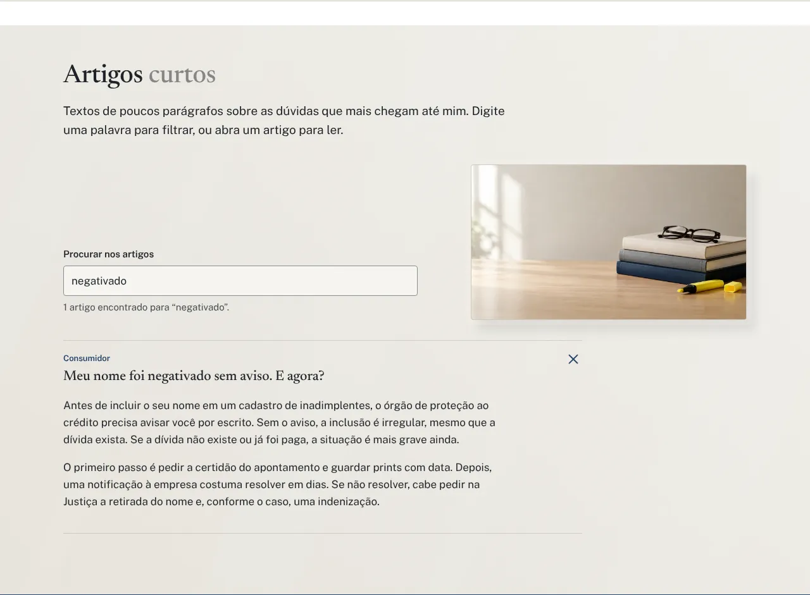

# Clara Montenegro, Advogada (site de demonstração)

Eu sou o Rodrigo Jr, da [Mil e Uma Linhas!](https://mileumalinhas.com.br). Este é um dos meus sites de vitrine: uma página completa feita para mostrar a um advogado ou advogada que atende sozinho como pode ser o site dele, com identidade própria e funções de verdade, e não um modelo pronto.

**Tudo aqui é fictício.** A advogada Clara Montenegro não existe, o número da OAB é 00.000, o endereço e o telefone foram inventados. Nenhum pedido feito no site é enviado para ninguém. É uma demonstração.

Publicado em: https://toshiro01001.github.io/advogado/

## O que o site é, para quem não é da área

É a página de uma advogada de família e consumidor em Cuiabá. Quem entra consegue:

1. Ler em que ela pode ajudar (família e consumidor) em texto curto e direto.
2. Responder três perguntas e receber a indicação da área do caso e do próximo passo.
3. Escolher dia e horário para uma consulta inicial e registrar o pedido (simulado).
4. Calcular até quando vai um prazo em dias úteis, do jeito que o processo civil conta.
5. Procurar e ler oito artigos curtos sobre dúvidas comuns.

Fiz questão de seguir o que a OAB espera de um site de advocacia: nenhuma promessa de resultado, nenhum preço de honorários como propaganda, linguagem sóbria e a expressão "consulta inicial" em vez de "consulta grátis".

## Como usar, passo a passo

1. Abra o site. O menu no topo leva a cada seção (no celular, toque em "Menu").
2. Em **Triagem**, marque uma resposta em cada pergunta e toque em "Ver a indicação". O resultado aparece embaixo. O botão "Pedir a consulta inicial" leva à agenda já com a área preenchida.
3. Em **Consulta**, escolha um dia disponível no calendário (dias em cinza estão tomados, são feriado ou já passaram), depois um horário, preencha nome e telefone e toque em "Registrar o pedido". O resumo aparece na tela e fica salvo só no seu navegador. "Apagar o que ficou salvo" limpa tudo.
4. Em **Prazos**, informe a data da intimação e a quantidade de dias, escolha dias úteis ou corridos e toque em "Calcular". O resultado mostra a data final e o que foi pulado (fins de semana, feriados, recesso).
5. Em **Artigos**, digite uma palavra no campo de busca (funciona sem acento) e toque em um título para abrir o texto.

## Capturas

Computador (1280x900):



Celular (iPhone 13):



Funções:

| Triagem | Agenda | Prazos | Artigos |
|---|---|---|---|
|  |  |  |  |

As mesmas funções no celular estão em `docs/funcao-*-celular.webp`.

## Identidade visual, em resumo

O estudo completo está em [`docs/identidade.md`](docs/identidade.md). O resumo:

- **Ideia:** a mesa de trabalho de uma pessoa que lê e anota, não um escritório de mármore. Papel, caneta de tinta azul e um marca-texto amarelo.
- **Paleta:** Papel `#F6F4EF` (fundo), Papel escuro `#ECE9E1` (blocos de apoio), Grafite `#1E2228` (texto), Tinta azul `#27456B` (tudo que é clicável), Marca-texto `#F2DC6B` (um grifo por tela, sempre atrás de texto), Linha `#CFCBC1` (bordas), Verde `#2F6B4F` (confirmação). Sem gradiente e sem sombra.
- **Fontes:** Newsreader (serifa de leitura, títulos) e Public Sans (sans clara, corpo e formulários). As duas são SIL OFL e estão na pasta `fonts/` com as licenças. Nenhuma fonte vem de fora.
- **Imagem forte:** uma folha de papel desenhada em CSS, com linhas pautadas, um trecho grifado e uma caneta em SVG. Nenhuma foto.
- **Movimento:** só um, na abertura: o grifo amarelo "passa" sobre o trecho do título. Com `prefers-reduced-motion`, ele já aparece pronto.

## Como funciona por dentro

O site é um conjunto de arquivos estáticos que o navegador baixa e executa sozinho. Não existe servidor de aplicação, banco de dados ou e-mail por trás.

- **Triagem:** uma tabela de decisão em `js/app.js`. Tema (família, consumidor, outro) define a área e o texto; momento (entender, já tentei, já há processo) define o próximo passo; urgência acrescenta um aviso. O botão do resultado preenche o campo "Área" da agenda.
- **Agenda:** o calendário é gerado a partir da data de hoje, só segunda a sexta, duas semanas por vez e até oito semanas à frente. Feriados nacionais são calculados (os fixos por data e Carnaval, Sexta-feira Santa e Corpus Christi pela Páscoa). Alguns dias e horários aparecem "tomados" por uma função determinística do dia, para a agenda parecer real sem ser aleatória a cada visita. O pedido é validado (nome, telefone com DDD, área) e salvo em `localStorage` na chave `cm-consulta`; ao reabrir o site, o resumo reaparece até ser apagado.
- **Prazos:** segue o CPC. Em dias úteis (art. 219), o dia da publicação fica de fora, a contagem começa no primeiro dia útil seguinte e cada dia útil conta um (art. 224). O recesso de 20 de dezembro a 20 de janeiro pode suspender a contagem (art. 220). Em dias corridos, soma-se o número de dias e, se o vencimento cair em dia sem expediente, ele passa para o próximo dia útil. O resultado lista o que foi pulado.
- **Artigos:** os oito textos estão no próprio HTML (dentro de `<details>`), e a busca filtra pelo título, pelo conteúdo e por palavras-chave em `data-tags`, ignorando acentos.

## Detalhes técnicos

- HTML, CSS e JavaScript puros. Sem framework, sem biblioteca, sem CDN, sem analytics, sem fonte externa.
- `Content-Security-Policy` por meta tag: `default-src 'self'`, `connect-src 'none'`, sem script ou estilo inline.
- Acessibilidade: contraste AA em todas as combinações (medido), foco visível de 3px, `fieldset` e `legend` nos formulários, `aria-pressed` nos dias e horários, `aria-live` nos resultados, link "Pular para o conteúdo", `lang="pt-BR"`, `prefers-reduced-motion` respeitado.
- Celular primeiro: uma coluna até 760px, menu recolhido, botões com 44px ou mais de altura, sem rolagem horizontal em 320px.
- Arquivos: `index.html` (página única com âncoras), `404.html` (caminhos absolutos `/advogado/`), `css/estilo.css`, `js/app.js`, `fonts/`, `favicon.svg`, `robots.txt`, `sitemap.xml`, `google20db0e080e71c701.html`, `docs/` (identidade, vistoria e capturas), `tests/site.cjs`.

## Como rodar no seu computador

Qualquer servidor de arquivos estáticos serve. O site espera responder em `/advogado/` (como no GitHub Pages), então sirva a pasta de cima:

```bash
cd /caminho/para/vitrine-novos
python3 -m http.server 8302
# abra http://127.0.0.1:8302/advogado/
```

## Testes

```bash
cd advogado
node tests/site.cjs
```

O script usa Playwright, sobe o servidor sozinho na porta 8302 e testa em 1280x900, iPhone 13 e 320px: abertura sem erro de console, sem rolagem horizontal e sem texto cortado; menu do celular; triagem; agenda (validação, máscara do telefone, gravação e apagamento no `localStorage`); prazos (três cenários com datas conhecidas); busca nos artigos; e a página 404. Com `CAPTURAS=1` ele também salva as capturas em PNG na pasta `CAP_DIR`.

## Segurança

Vistoria curta em [`docs/vistoria.md`](docs/vistoria.md). Em resumo: CSP restritiva, nenhum dado sai do navegador, uma única chave de `localStorage` com aviso e botão para apagar, nenhuma dependência em produção, nenhum dado real no repositório.

---

Feito por Rodrigo Jr, [Mil e Uma Linhas!](https://mileumalinhas.com.br), Cuiabá.
